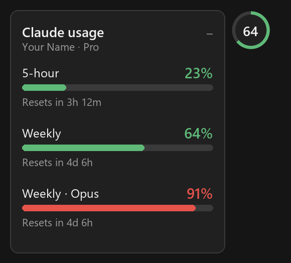

# Claude Usage Widget (unofficial)

A small floating button for Windows that shows how much of your Claude plan you have used.
The number and ring on the button are your weekly usage. Click it to see every limit and when it resets.



**Unofficial. Not made, endorsed or supported by Anthropic.**

## Download

**[⬇ Download the latest installer](https://github.com/lowjinghong29/claude-usage-widget/releases/latest/download/ClaudeUsageWidget-Setup.exe)** (Windows 10/11, 64-bit)

All versions and their checksums: [Releases](https://github.com/lowjinghong29/claude-usage-widget/releases).

## Before you install

You need **Claude Code signed in with a Claude subscription** (Pro, Max or similar) on the same PC.
Either of these counts:

- The **Code** tab in the [Claude desktop app](https://claude.ai/download), signed in, or
- The `claude` command line, signed in with `claude auth login`.

If you are not signed in yet, that's fine: the widget shows a **Sign in to Claude Code** button that
opens Claude Code's own sign-in in your browser. An API key (Console) login has no plan limits to show.

## Install

1. Download `ClaudeUsageWidget-Setup.exe` (link above).
2. **Optional, recommended:** check the file is exactly the published one. In PowerShell, in your Downloads folder:
   ```powershell
   Get-FileHash .\ClaudeUsageWidget-Setup.exe -Algorithm SHA256
   ```
   The result must match the line in `SHA256SUMS.txt` on the release page.
3. Run the installer. It is **not code-signed**, so Windows will likely say **"Windows protected your PC"**.
   Click **More info**, then **Run anyway**. Your browser may also ask whether to keep the file: choose **Keep**.
4. Follow the steps. It installs for your Windows user only (no admin rights needed), adds a Start menu entry,
   and by default starts the widget each time you sign in to Windows.

## Use

| Do this | To |
|---|---|
| Click the button | Open or close the usage panel |
| Drag the button | Move it anywhere on screen |
| Right-click the button | Quit the widget |
| Click `–` in the panel | Minimize back to the button |
| Double-click the panel | Refresh now |

- The number on the button is your **Weekly (all models)** usage in percent.
- Colours: **green** below 70%, **amber** below 90%, **red** from 90%.
- It refreshes every 5 minutes, and straight away when you switch Claude Code accounts.
- To start it again after quitting: Start menu → **Claude Usage Widget**.

### Your own picture in the ring

Save any PNG as `%USERPROFILE%\.claude-usage-widget\center.png` and restart the widget:
it shows your picture inside the ring instead of the number. Small pixel art (64 px wide or less)
is scaled up sharply; bigger pictures are shrunk to fit. Delete the file to get the number back.

## Troubleshooting

| You see | What to do |
|---|---|
| "Windows protected your PC" | Normal for unsigned apps. **More info → Run anyway**. |
| "Not signed in to Claude Code on this PC." | Click **Sign in to Claude Code** and approve in your browser, or sign in from the Claude desktop app's **Code** tab. |
| "Claude Code is not installed on this PC." | Install the [Claude desktop app](https://claude.ai/download) and sign in on its **Code** tab, or install Claude Code. |
| "Claude Code sign-in has expired." | Click **Sign in to Claude Code**, or open Claude Code once. |
| "Rate limited by Anthropic, retrying in N min" | Anthropic asked it to slow down. Wait: it retries by itself and keeps showing the last numbers. |
| "Can't reach Anthropic." | Check your internet connection, VPN or proxy. |
| No button on screen | Start menu → **Claude Usage Widget**. Only one copy runs at a time. |
| Your company PC hides **Run anyway** | Your IT team blocks unsigned apps; ask them to allow it. |

## Security and privacy

- **What it reads:** your Claude Code sign-in (`%USERPROFILE%\.claude\.credentials.json`), and your account
  name and plan from `%USERPROFILE%\.claude.json`. Nothing else.
- **Where it sends it:** only to `https://api.anthropic.com/api/oauth/usage`, over HTTPS, to ask for your usage.
  No other server. No analytics, no telemetry, no update checks.
- **What it stores:** nothing. Your sign-in stays in memory and is never written, logged or shown.
  Messages in the panel are fixed texts and never contain file contents.
- **What it runs:** only Claude Code's own `claude auth status` (to renew an expired sign-in) and
  `claude auth login` (when you click **Sign in**).
- **How often it calls Anthropic:** at most once every 30 seconds, about every 5 minutes on its own,
  and it backs off when Anthropic asks it to (HTTP 429).
- **It does not** read your chats or code, use your Claude credits, or change your settings.
- The usage address is **not a documented Anthropic API**. It may change or stop working at any time.
- Found a security problem? See [SECURITY.md](SECURITY.md). Please don't open a public issue for it.

## Uninstall

Settings → Apps → Installed apps → **Claude Usage Widget (unofficial)** → Uninstall.
This removes the app and its start-at-sign-in shortcut. It never touches your Claude sign-in.

## FAQ

**Does it work on Mac or Linux?** No, Windows only.

**Does it cost anything or use my Claude limits?** No. It only reads the usage numbers.

**Why does it need Claude Code?** Your plan usage is only available through your own Claude Code sign-in.
The widget never asks for your password: signing in always happens in Claude Code's own browser flow.

## Build from source

Needs Python 3.14 and [Inno Setup 6](https://jrsoftware.org/isinfo.php) on Windows.

```powershell
python -m pip install --user -r requirements-build.txt
python build.py
```

Output: `dist\ClaudeUsageWidget-Setup.exe`. Quick self-check: `python claude_usage_widget.pyw --test`.
To run without installing: `pythonw claude_usage_widget.pyw` (needs `pillow`).

## License

MIT. See [LICENSE](LICENSE). Claude is a trademark of Anthropic, PBC. This project is not affiliated with Anthropic.
